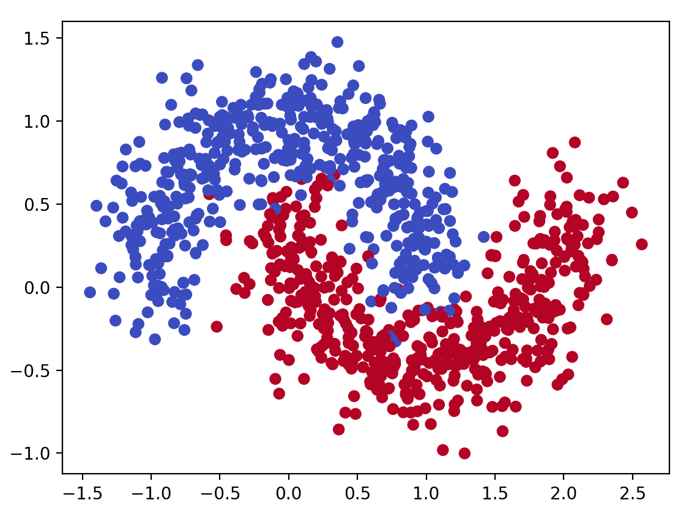
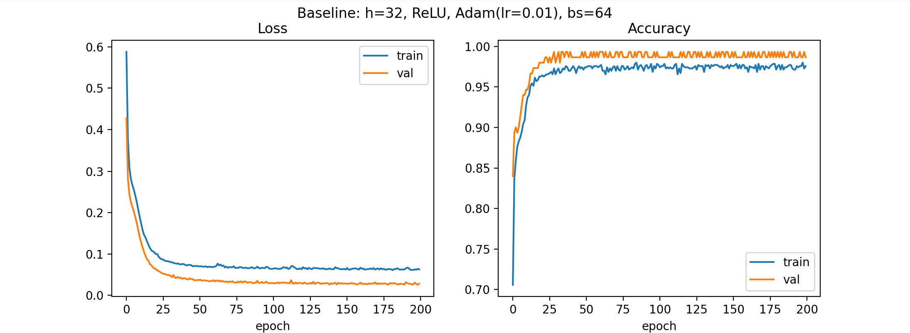
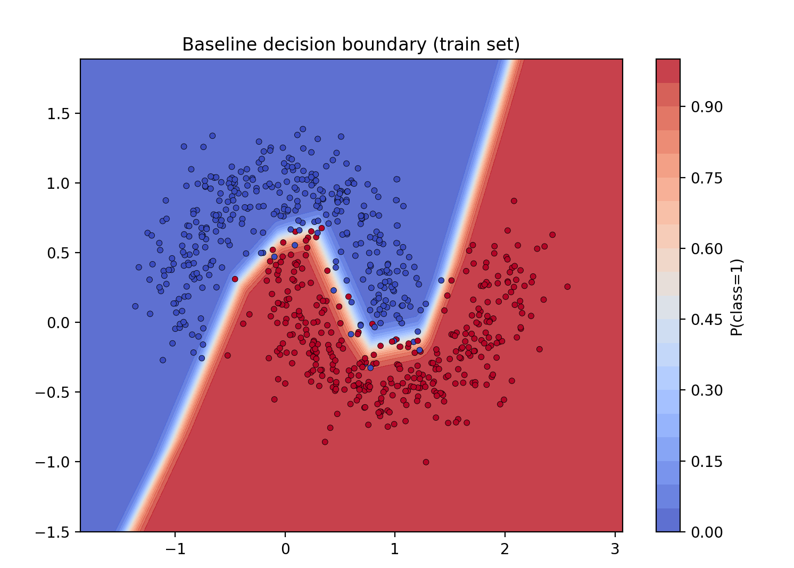

# 本题我学习和部分思考内容

 ## **部分完成过程和学习内容我放到了代码的注释中。**

 
 
 1.**你在这个任务之中，选择了什么激活函数，为什么选这个？**

 我选择的激活函数是ReLU函数：max（0，x），其计算简单、且可以缓解梯度消失。

 2.**你选择了什么损失函数？为什么？那如果这一题是三分类问题呢？**

 

 3.**optimizer.zero_grad()、loss.backward() 和 optimizer.step() 分别完成了什么工作？如果不清空梯度会发生什么？**

 4.**更深、更宽的神经网络一定能取得更好的效果吗？模型过于简单或过于复杂分别可能带来什么问题？**

5.**学习率过大或过小会怎样影响模型训练？你能从 loss 曲线中观察到哪些现象？**

学习率过小会导致每次更新参数时其变化很小，梯度下降过慢；学习率过大会导致更新参数后损失函数越过最小值，无法达到最小值，甚至可能出现梯度下降无法收敛。

6.**假设还有一个分类问题，但是两个类别的样本数量非常不均衡，训练出来的模型会怎么样？为什么？说明了什么？ 你可以尝试构造一个数据集试试看**

7.**如果想要过拟合这个数据集，你会怎么做？为什么？试试看能不能实现吧！（在别的数据集也可以）训练过程和数据呈现和正常训练有何不同？你通过什么判断他过拟合？**

## 附图：

主实验

1.make_moons生成的数据可视化图：

2.loss/accuracy曲线图：

3.二维决策边界图：

4.混淆矩阵图：

