# 本题我学习和部分思考内容

 ## **部分完成过程和学习内容我放到了代码的注释中。**

 
 
 1.**你在这个任务之中，选择了什么激活函数，为什么选这个？**

 我选择的激活函数是ReLU函数：max（0，x），其计算简单、且可以缓解梯度消失。

 2.**你选择了什么损失函数？为什么？那如果这一题是三分类问题呢？**

 我选择了交叉熵误差函数CrossEntropyLoss()，因为中由于对数的作用，模型自信选错类别时小预测概率值会被-log明显放大，可以更好的区分好模型和不好的模型。

 如果这道题是三分类问题，我仍旧会使用交叉熵损失函数，因为它只关注选择正确类的概率高不高，其他类有几个，概率多少不在意，它天然就适配处理多分类问题，且计算量不会因为分类变多而增加。

 3.**optimizer.zero_grad()、loss.backward() 和 optimizer.step() 分别完成了什么工作？如果不清空梯度会发生什么？**

optimizer.zero_grad()用于清空梯度；loss。backward()用于反向传播时计算损失函数对每个参数的偏导，并存进param.grad;optimizer.step()用于根据param.grad和优化器规则，更新参数值。

如果不清空梯度，每轮的梯度会不断累加，导致梯度*学习率变大，等效于学习率不断增大，会导致loss函数无法收敛。

 4.**更深、更宽的神经网络一定能取得更好的效果吗？模型过于简单或过于复杂分别可能带来什么问题？**
 更宽、更深的神经网络效果不一定好，模型的复杂度要与数据复杂度匹配。模型过于简单会导致欠拟合，训练和验证误差都高，从我做的宽度=4的对照试验就可看出，此时决策边界太简单，完全分不开两个月牙。过复杂则容易过拟合，训练误差很低但验证误差升高，把噪声点也记住了。同时参数更多，训练更慢。（PS：但是我实验时仅增加隐藏层宽度却并未出现明显过拟合）
 
下面是改变隐藏层宽度和层数和层数的实验组的loss/accuracy图和决策边界图：

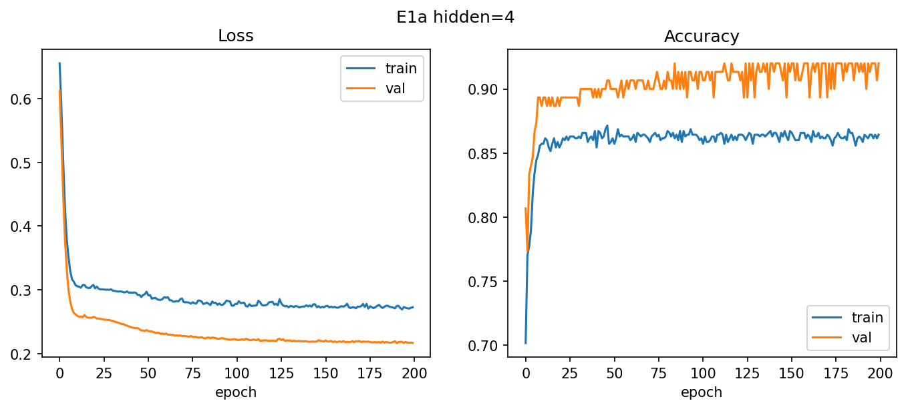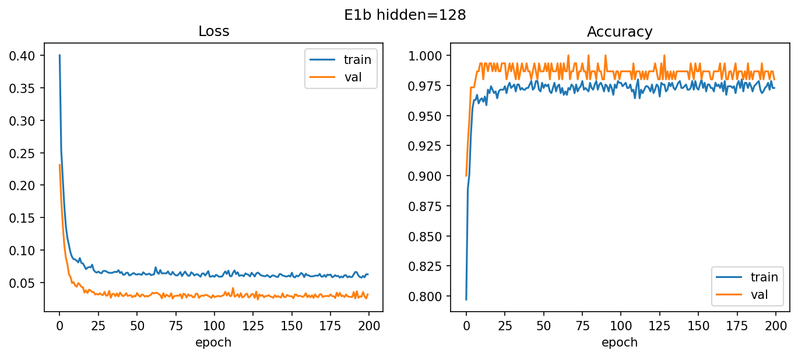


5.**学习率过大或过小会怎样影响模型训练？你能从 loss 曲线中观察到哪些现象？**

学习率过小会导致每次更新参数时其变化很小，梯度下降过慢；学习率过大会导致更新参数后损失函数越过最小值，无法达到最小值，甚至可能出现梯度下降无法收敛。

在我的对照实验中也体现出这个现象，学习率=0.001（过小）时损失函数收敛很慢，200轮都未收敛，学习率=0.5（过大）时loss函数发生剧烈震荡，反复升降，无法收敛。

曲线图如下：

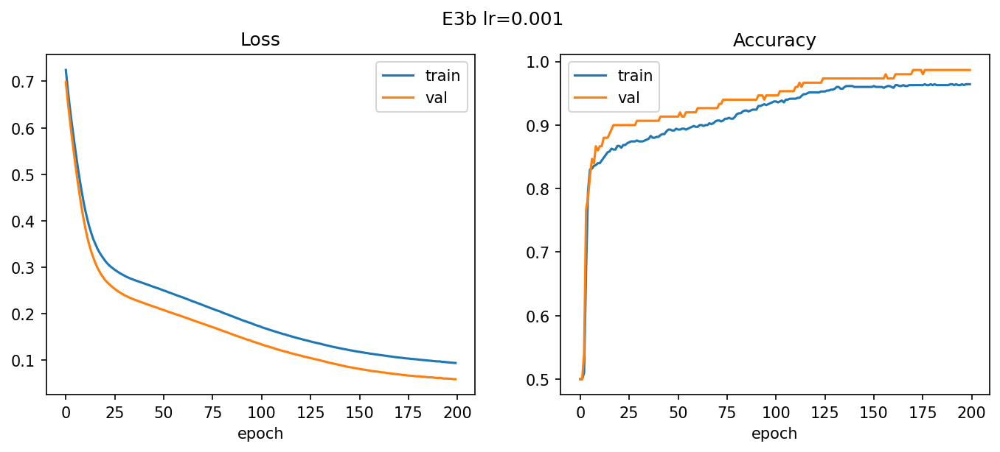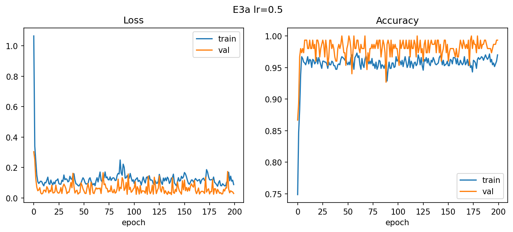


6.**假设还有一个分类问题，但是两个类别的样本数量非常不均衡，训练出来的模型会怎么样？为什么？说明了什么？ 你可以尝试构造一个数据集试试看**

在样本不均衡时，模型会倾向于预测样本多的那类，导致其表面训练准确率高，但其对少数类的预测成功率很低。因为交叉熵按样本数平均，多数类的损失占绝对主导，模型只需"全猜多数类"就能把损失压得很低，这导致其准确率虚高，但少数类召回率接近 0，完全失效。这说明准确率在不均衡数据里具有欺骗性，必须看每类的召回率或混淆矩阵来判断模型好坏。

7.**如果想要过拟合这个数据集，你会怎么做？为什么？试试看能不能实现吧！（在别的数据集也可以）训练过程和数据呈现和正常训练有何不同？你通过什么判断他过拟合？**

我可以增加隐藏层宽度，隐藏层数，或者降低训练样本数，增加训练轮数。或者故意泄露验证集数据（！）。

我在进行过拟合试验时，这么设置参数：隐藏层宽度32->256，深度1->10，轮数200->800,噪声0.2->0.4,样本总数1000->60,batch_size 64->8,得到了~~极品~~过拟合图像。

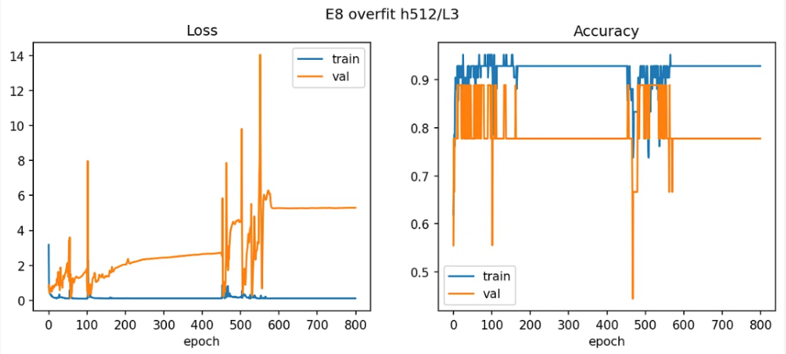

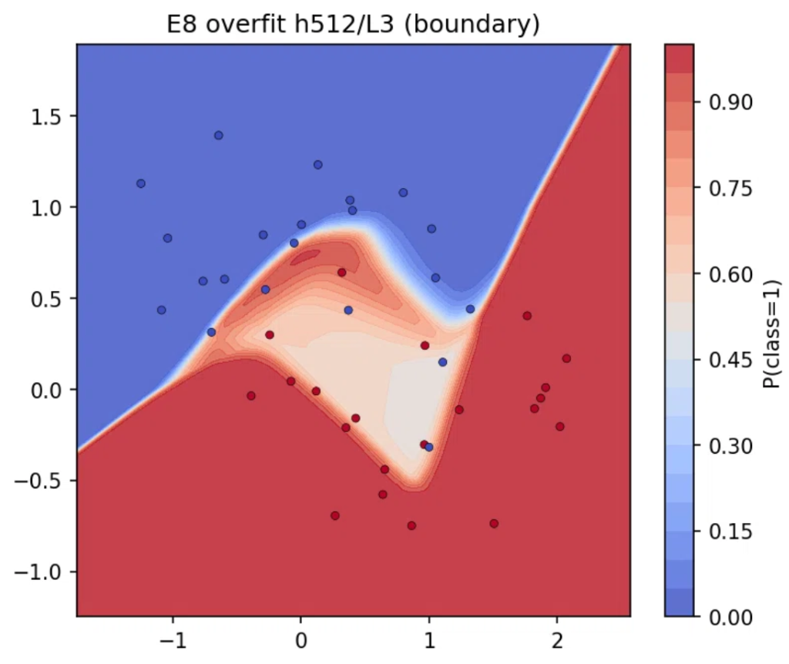

其中，在左图loss/accuracy曲线中可看出，训练loss迅速收敛为0，验证loss一开始就高于训练loss，且随训练轮数上升loss不断上升且出现剧烈的抖动，与主试验训练、验证loss都不断下降最后收敛的现象完全不同，accuracy曲线的情况也相似，与过拟合的“模型在训练集表现号，验证/测试集表现差”吻合，我因此判断其过拟合。而右图决策曲线可看出图中决策边界有棱有角而不像主试验那样平滑呈月牙形，且中部出现明显的与月牙边缘反向的红色倒三角，我看出这是模型为了将中间三个红点强行容纳进来，因此判断其过拟合。

## 主实验（对照组）


1.make_moons生成的数据可视化图：

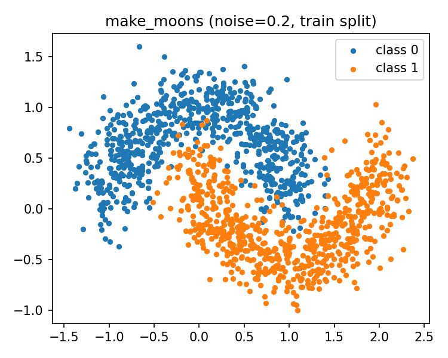

2.loss/accuracy曲线图：

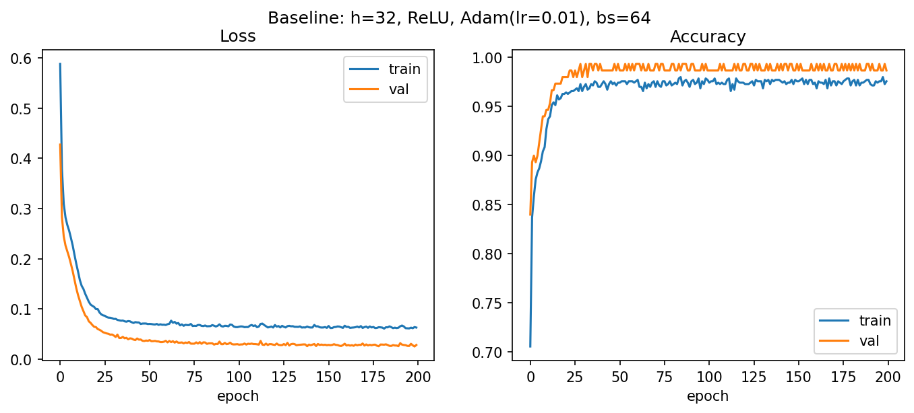

PS：这里出现了令我意外的现象：验证集表现好于训练集。可能是验证集随机选取时点更集中在月牙附近导致。

3.二维决策边界图：

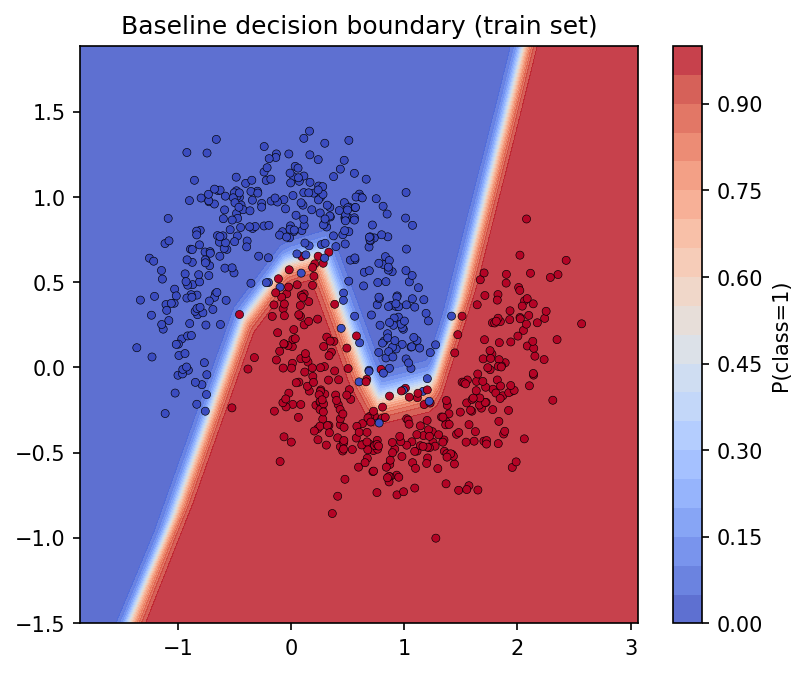

4.混淆矩阵图：

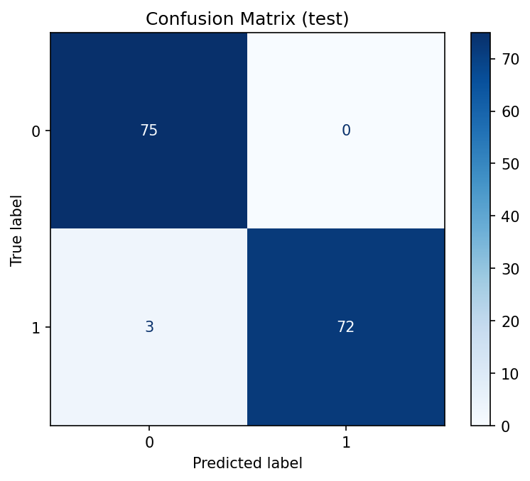

5.错误样例：

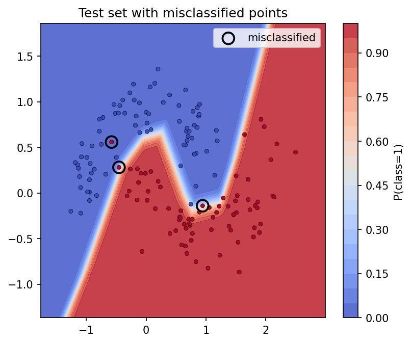

6.所有运行指令和输出

```python
(base) PS C:\\WINDOWS\\System32> conda activate ml-env
(ml-env) PS C:\\WINDOWS\\System32> cd D:/python练习
(ml-env) PS D:\\python练习> python main.py
D:\\python练习\\main.py:42: UserWarning: FigureCanvasAgg is non-interactive, and thus cannot be shown
  plt.show()
  ep 50 | train loss 0.0699 acc 0.9743 | val loss 0.0364 acc 0.9933
  ep100 | train loss 0.0637 acc 0.9771 | val loss 0.0298 acc 0.9867
  ep150 | train loss 0.0623 acc 0.9757 | val loss 0.0278 acc 0.9933
  ep200 | train loss 0.0628 acc 0.9757 | val loss 0.0282 acc 0.9867
[baseline] params=162  time=5.91s  peak_mem=17.3MB
D:\\python练习\\main.py:145: UserWarning: FigureCanvasAgg is non-interactive, and thus cannot be shown
  plt.savefig(fname, dpi=150, bbox_inches='tight'); plt.show()
D:\\python练习\\main.py:164: UserWarning: FigureCanvasAgg is non-interactive, and thus cannot be shown
  plt.show()
加载后测试集 acc = 0.9800
Test accuracy: 0.9800
D:\\python练习\\main.py:195: UserWarning: FigureCanvasAgg is non-interactive, and thus cannot be shown
  plt.savefig('fig4_confusion.png', dpi=150, bbox_inches='tight'); plt.show()
错误样本数: 3 / 150
  idx= 19  X=(+0.94,-0.14)  true=1  pred=0  P(class1)=0.438
  idx= 94  X=(-0.45,+0.28)  true=1  pred=0  P(class1)=0.300
  idx=134  X=(-0.58,+0.56)  true=1  pred=0  P(class1)=0.000
D:\\python练习\\main.py:164: UserWarning: FigureCanvasAgg is non-interactive, and thus cannot be shown
  plt.show()
D:\\python练习\\main.py:145: UserWarning: FigureCanvasAgg is non-interactive, and thus cannot be shown
  plt.savefig(fname, dpi=150, bbox_inches='tight'); plt.show()
D:\\python练习\\main.py:152: RuntimeWarning: More than 20 figures have been opened. Figures created through the pyplot interface (`matplotlib.pyplot.figure`) are retained until explicitly closed and may consume too much memory. (To control this warning, see the rcParam `figure.max_open_warning`). Consider using `matplotlib.pyplot.close()`.
  plt.figure(figsize=(6, 5))

experiment                           params  time(s)   val_acc  test_acc   mem(MB)
baseline h32/relu/adam/lr.01/bs64       162     5.91    0.9867    0.9800      17.3
E1a hidden=4                             22      5.2    0.9200    0.9200      17.3
E1b hidden=128                          642     5.34    0.9800    0.9667      17.4
E2a act=tanh                            162    10.53    0.9867    0.9733      17.3
E2b act=sigmoid                         162    11.44    0.9867    0.9733      17.3
E3a lr=0.5                              162     7.06    0.9933    0.9733      17.3
E3b lr=0.001                            162     4.55    0.9867    0.9800      17.3
E4 optimizer=SGD                        162     4.76    0.9067    0.9133      17.3
E5a batch_size=8                        162    47.46    0.9867    0.9800      17.3
E5b batch_size=1024                     162     1.29    0.9867    0.9800      17.4
E6c n_layers=10                        3330    15.21    0.9867    0.9800      17.4
```

8.其他实验组图表：
- 1.改变激活函数
- 
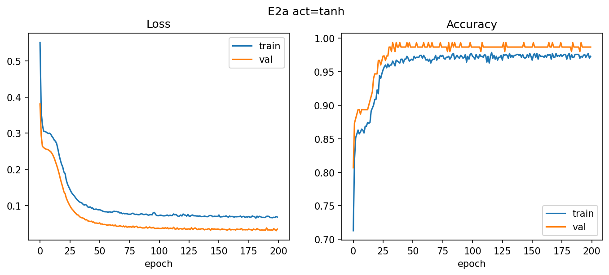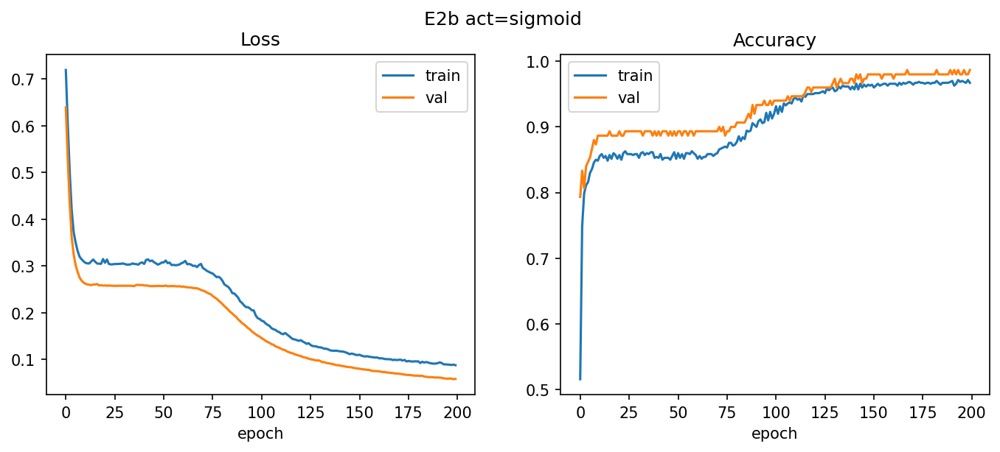


- 2.改变优化器

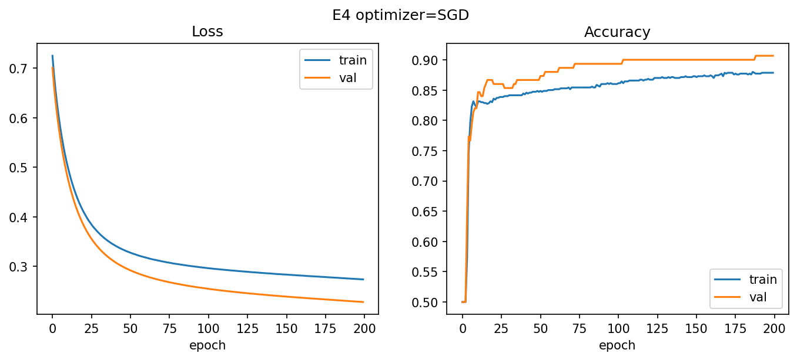


- 3.改变batch_size


- 4.改变隐藏层数


