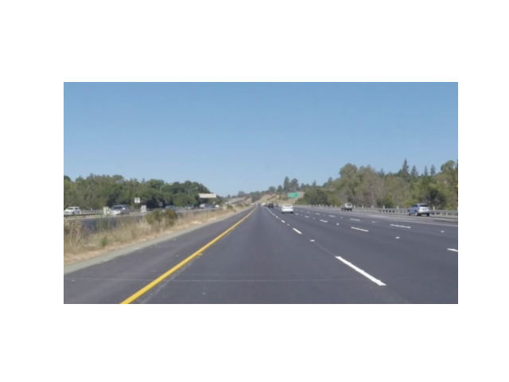
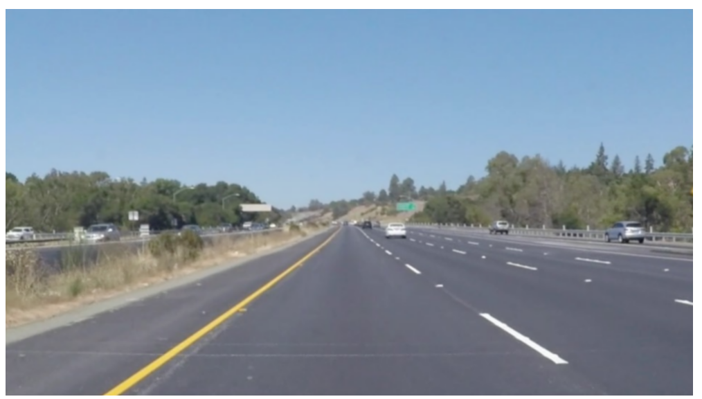
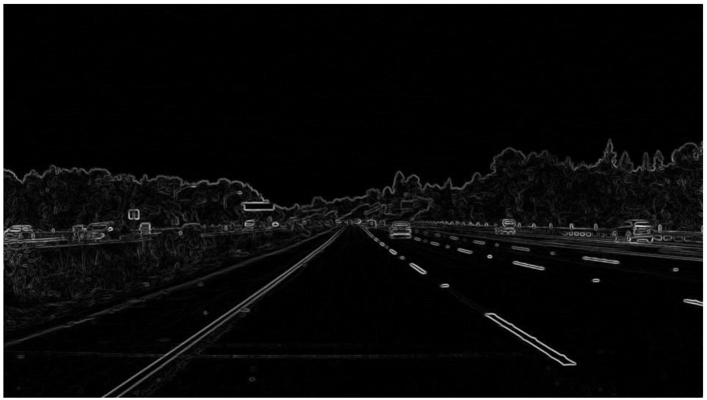

# 实践 1 任务清单
## 1.了解数字图片如何被表示，并回答：像素是什么？什么是 RGB？灰度图和彩色图有什么区别？

像素是图像被网格分割后的小方格，是组成图像的最小单位。

RGB是红绿蓝三种光的缩写，显示器通过这三种颜色不同强度的组合（R,G,B）(每个为0~255)来混合出各种颜色。

PS：RGBA：在RGB的基础上，新增一种表示透明度的通道（值0~255），其中0为完全透明看不见，255为完全不透明。

灰度图中，每个像素只记录一个亮度值，从黑到白。比如0是黑，255是白中间是各种灰。其信息量较小，占用内存也小， 彩色图中，每个像素记录RGB三个通道的值，能表现丰富的色彩，但数据量通常是灰度图的 3 倍。

## 2.使用上面这张图片，用 Pillow 或其他图像读取工具将它转换为 NumPy 数组和 PyTorch Tensor。打印他的的 shape、dtype、最大值和最小值，再打印一个像素的 RGB 数值。说明每个维度和数值分别表示什么，以及 NumPy/Pillow 常见的 HWC 与 PyTorch 常见的 CHW 排列有什么区别。

代码及运行结果：

```python
from PIL import Image
import numpy as np
import torch

img = Image.open("highway.png") 
print(img.size)   # (宽, 高)
print(img.mode)   # 通常是 'RGB'

#arr(x,y)=(R(x,y),G(x,y),B(x,y));arr(x,y,颜色)=(0~255（该颜色强度）)
arr = np.array(img)   #arr是二维数组，每个元素对应一个小方格，每个元素包含该格红/绿/蓝三色强度的三个数值     
print(arr.shape)  #arr.shape=(高/行数，宽/列数，颜色通道数（3）)
print(arr.dtype)   #每个数值占1字节，为0~255
print(arr.max(), arr.min())  #整张图最暗和最亮的通道值
print(arr[0, 0])   # 左上角像素的 RGBA

tensor = torch.from_numpy(arr)          # 转换Tensor，此时形状仍是 (H, W, 4)
print(tensor.shape, tensor.dtype)
print(tensor.max(), tensor.min())
print(tensor[0, 0])                     

# 变成CHW并归一化
tensor_chw = tensor.permute(2, 0, 1).float() / 255.0  #C换到H，W前面
print(tensor_chw.shape)
```
运行结果：
```python
(1512, 852)
RGBA
(852, 1512, 4)
uint8
255 18
[145 168 193 255]
torch.Size([852, 1512, 4]) torch.uint8
tensor(255, dtype=torch.uint8) tensor(18, dtype=torch.uint8)
tensor([145, 168, 193, 255], dtype=torch.uint8)
torch.Size([4, 852, 1512])
```
其中，arr.shape=(高/行数，宽/列数，颜色通道数)，arr.dytpe表示数组中数据类型，这里为unit8，最大值和最小值即整张图最暗和最亮的通道值，在0~255之间，R,G,B分别对应该处像素的红绿蓝颜色的强度，也是从0到255。

HWC和CHW区别是表示的维度顺序不同，HWC为（高，宽，通道数），CHW为（通道数，高，宽）


## 3.了解二维卷积的基本过程。用自己的话解释：卷积核是什么？它在图片上怎样移动？每到一个位置进行了什么计算？

卷积核是一个矩阵，也是一个处理数字化后输入图像函数。它在图片上一开始在左上，然后按步长依次向右、下滑动（平移），在每一个位置于图像的数字化矩阵对应像素值相乘再累加，类似点乘计算得到输出矩阵上的每一个值。

## 4.仅使用 Python 和 NumPy，手写一个能够处理灰度图或 RGB 图片的二维卷积函数。核心卷积过程不能调用 cv2.filter2D、scipy.signal.convolve2d、torch.nn.Conv2d 等现成实现。

我写了能够处理灰度图的二维卷积函数
```python
#卷积函数
def convolve2d(gray_img, kernel):
    
    gray_arr = np.array(gray_img)   

    W,H=gray_img.size[0],gray_img.size[1]
    kH,kW=kernel.shape

    Hout,Wout=H-kH+1,W-kW+1
    cv = np.zeros((Hout,Wout ), dtype=np.float64)#输出灰度矩阵
    for i in range (Hout):
        for j in range (Wout):
            patch = gray_arr[i:i+kH, j:j+kW]   #左闭右开
            cv[i,j] = (kernel * patch).sum()
    #print(cv)
    return cv
#以下为测试
gray_img = img.convert('L')   #转灰度图
kernel_1 = np.array([[0, 1, 0],
                   [1, -4, 1],
                   [0, 1, 0]], dtype=float)
result=convolve2d(gray_img,kernel_1)
print(result)

```
测试结果
```python
[[ -8.   0.  -3. ...   4.   1.   8.]
 [ 15.   5.  -1. ...   0.   2. -10.]
 [  8.   0.   1. ...   0.   1.   5.]
 ...
 [  7.   1.  -1. ...   2.   5.  19.]
 [ 13.   1.   0. ...   5.   6.  17.]
 [ 14.   0.  -5. ...  17.  17.  15.]]
```

## 5.至少使用下面四种卷积核处理同一张图片，把原图和结果放在一起比较：

原图


**均值模糊：使用 3×3 的均值卷积核；**




**高斯模糊：使用 5×5 的高斯卷积核，可以查阅高斯函数并自行生成或填写卷积核；**




**锐化：例如使用 [[0,-1,0],[-1,5,-1],[0,-1,0]]；**


**边缘检测：使用 Sobel-X 和 Sobel-Y，尝试把两个方向的结果合成为一张边缘图。**




## 6.观察并解释每种处理带来的变化：为什么均值与高斯卷积会让图片变模糊？为什么锐化会让边缘更明显？Sobel 卷积核为什么能找到边缘？

1.均值与高斯模糊把中心像素和周围的像素平均了。原本黑白分明的边界，经过平均后混合出了灰色，过渡区域变宽，视觉上就糊了。

2.因为锐化核中心为正，四周为负。它会放大差异，拉大了对比度，边缘就更明显了。

3.因为边缘是像素值突变的地方。Sobel核一边是正数、一边是负数，它算得是相邻像素的差值，在遇到边缘时，差值极大，从而能找出来。

## 7.分别尝试不填充（valid）和适当填充（same）图片边缘，比较输出尺寸与边缘像素的变化。记录卷积核大小、padding、stride 与输出尺寸之间的关系。

我输入5x5，卷积核3x3，步长2，padding填充1，Wout=3

我输入7x7，卷积核3x3，步长2，padding填充1，Wout=4

我输入5x5，卷积核3x3，步长1，padding填充0，Wout=3

关系公式：Wout=floor((Win+2*padding-F)/stride)+1            （F为卷积核尺寸）
