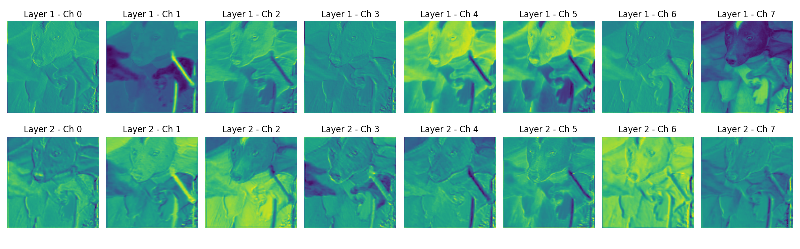
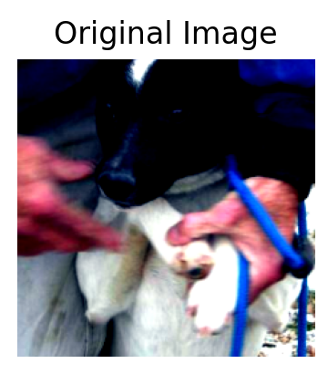

# 实践 2：训练猫狗分类器   任务集

**1.下载并观察数据集，统计猫和狗各有多少张；随机展示一些图片，看看它们的尺寸、清晰度和拍摄背景是否相同。**

训练集：猫12500，狗12500，测试集猫狗共12500张。

我看了一些图，这些图尺寸、清晰度、背景基本都不同。

**2.为猫狗图片编写数据读取与预处理流程。你准备怎样把它们组成一个 batch？随机展示预处理前后的图片，检查是否出现拉伸、裁剪错误或颜色异常。**

我把训练集分出10%为验证集用于本地评估，然后我将训练集和测试集的每张图片随机裁剪压缩为了224x224像素。且我的batch_size=64。我检查了8张图片，未出现拉伸、裁剪错误或颜色异常这些异常情况。

**3.搭建一个包含卷积层、激活函数和池化层的 CNN。**

此任务已完成，内容放在代码里。我用了RELU激活函数，且卷积层和池化层各两个。

**4.记录一张图片经过 CNN 各层后的 Tensor 形状，说明宽、高和通道数发生了什么变化。**

图片的Tensor（[B,C,H,W]）的变化：
原：[1,3,224,224]-第一卷积层->[1,16,224,224]-第一池化层->[1,16,112,112]-第二卷积层->[1,32,112,112]
-第二1池化层->[1,32,56,56]->展平->[1,100352]->全连接层1降维->[1,128]-全连接层2降维->[1,2]

PS： 卷积层输出尺寸：O=((W-K+2P)/S)+1,池化层输出尺寸：O=((W-K)/S)+1

**5.从测试集中选择几张图片，将第一层或最后一层卷积输出的部分特征图可视化。不同通道对同一张图片产生了什么结果？它们可能关注颜色、边缘、纹理还是其他信息？**

   

PS：哪类图案位置上特征图高亮，就说明核对这类特征敏感

通过输出的特征图和原图的对比，很容易看出来，第一层特征图更关注颜色和边缘，在特征图中，肉色的人手，蓝色的绳子被清晰勾勒出了，如Ch1，5，7。

经过了一次池化（尺寸缩小）和第二次卷积，图片看起来变得模糊了，但其不同通道之间的分工变得更“高级”，卷积核开始把边缘组合起来，比如 L2 Ch 10，亮斑集中在人的手臂和白毛交界处，它可能在识别“某个物体的轮廓边界”。纹理与区域：在L2 Ch 12中，中间有一大片非常亮的黄色，这块区域对应的是原图中衣服和毛发交界的复杂纹理区。模型可能在这里提取到了“毛茸茸”或者“布料褶皱”的特征。

**6.设计一组有关数据增强的对照实验，例如“无增强”与“随机水平翻转、随机裁剪或颜色扰动”。展示增强后的样本，并分析哪些变换可能合理，哪些变换可能破坏标签或让图片失真。**

**7.查看模型预测错误的样本，分析原因？看看能不能做出相应改进？记录下这个过程。**

**8.保存你认为表现最好的模型，并编写一个独立的推理程序：输入一张本地图片，程序自动完成与训练时一致的预处理，输出“猫/狗”、预测概率和处理后的图片。绘制你的模型结构图。**

# 趁热打铁部分

**1.卷积层为什么比直接使用一个巨大的全连接层更适合处理图片？试着用全连接层试试看实现本任务？对比一下差距**

全连接层把图拉平，参数爆炸（224×224×3 接 512 神经元就约 7700 万参数），且丢失空间结构、对位置敏感、极易过拟合。卷积靠局部连接+参数共享（3×3×3×16 仅 432 参数），保留空间关系、有平移不变性。同样 5 epoch，全连接通常 60%~70%，SimpleCNN 80%+，ResNet18 95%+。

**2.卷积层的输入通道和输出通道分别表示什么？它们与卷积核的数量有什么关系？**

输入通道表示输入的特征图有多少个图层，第一次是RGB三个。输出通道表示本层卷积核从输入图中提取多少个新特征，生成多少个新特征图。

其中，输出通道数=卷积核个数，每个卷积核接收所有输入通道后产生一个输出通道。

**3.padding、stride 和 pooling 会怎样改变特征图的尺寸？请结合自己网络中的一层实际计算。**

公式：H_out = (H_in + 2P - K)/S + 1，Wout同理

在第一个池化层，步长s=2，扩充padding=0，池化核尺寸k=2，输入图尺寸=224

 Pool1 =（（224+0*2-2）/2）+1=112

 在这一层中特征图尺寸：224->112
·

**4.随着网络逐层计算，特征图的宽和高通常越来越小，通道数却可能越来越多，这是为什么？**

这是因为计算过程中，池化/大步长对图片做空间降维，扩大感受野、减少计算；通道增多是为了表达更抽象丰富的语义特征。大体上是减少其空间而增加其特征的表达。

**5.你选择了什么激活函数和损失函数？它们为什么适合这道二分类题？**

激活函数我选择了 ReLU，它的特点是训练快、缓解梯度消失、带稀疏性。
损失函数我选择了交叉熵（CrossEntropyLoss）损失函数，它适合二分类及以上分类，梯度简洁稳定，且PyTorch 内部已含 LogSoftmax。

**6.为什么训练集上的随机数据增强不应该原样用在验证集和测试集上？翻转、裁剪和颜色变化分别可能带来什么帮助或问题？**

因为验证/测试要评估稳定、反映真实分布，随机增强会让每次指标波动、评估失真。训练增强是为了扩增数据，提升泛化。

以下随机增强的方式的带来的帮助或问题：

- 1.翻转：可以帮助左右对称物体扩增；对有方向性的任务，比如文字有害。
- 2.裁剪：可以帮助适应位置和尺度变化；过度裁剪会切掉主体，产生标签噪声。
- 3.颜色变化：可以帮助适应光照条件；过度会破坏颜色线索、偏离真实分布。

