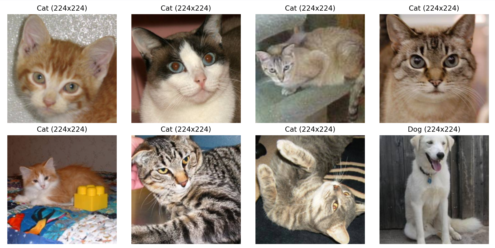

# 实践 2：训练猫狗分类器   任务集

**1.下载并观察数据集，统计猫和狗各有多少张；随机展示一些图片，看看它们的尺寸、清晰度和拍摄背景是否相同。**

训练集：猫12500，狗12500，测试集猫狗共12500张。

我看了一些图，这些图尺寸、清晰度、背景基本都不同。

**2.为猫狗图片编写数据读取与预处理流程。你准备怎样把它们组成一个 batch？随机展示预处理前后的图片，检查是否出现拉伸、裁剪错误或颜色异常。**

我把训练集分出10%为验证集用于本地评估，然后我将训练集和测试集的每张图片随机裁剪压缩为了224x224像素。且我的batch_size=64。我检查了8张图片，未出现拉伸、裁剪错误或颜色异常这些异常情况。

**3.搭建一个包含卷积层、激活函数和池化层的 CNN。**

此任务已完成，内容放在代码里。我用了RELU激活函数，且卷积层和池化层各两个。

**4.记录一张图片经过 CNN 各层后的 Tensor 形状，说明宽、高和通道数发生了什么变化。**

PS： 卷积层输出尺寸：O=((W-K+2P)/S)+1,池化层输出尺寸：O=((W-K)/S)+1

**5.从测试集中选择几张图片，将第一层或最后一层卷积输出的部分特征图可视化。不同通道对同一张图片产生了什么结果？它们可能关注颜色、边缘、纹理还是其他信息？**

**6.设计一组有关数据增强的对照实验，例如“无增强”与“随机水平翻转、随机裁剪或颜色扰动”。展示增强后的样本，并分析哪些变换可能合理，哪些变换可能破坏标签或让图片失真。**

**7.查看模型预测错误的样本，分析原因？看看能不能做出相应改进？记录下这个过程。**

**8.保存你认为表现最好的模型，并编写一个独立的推理程序：输入一张本地图片，程序自动完成与训练时一致的预处理，输出“猫/狗”、预测概率和处理后的图片。绘制你的模型结构图。**

