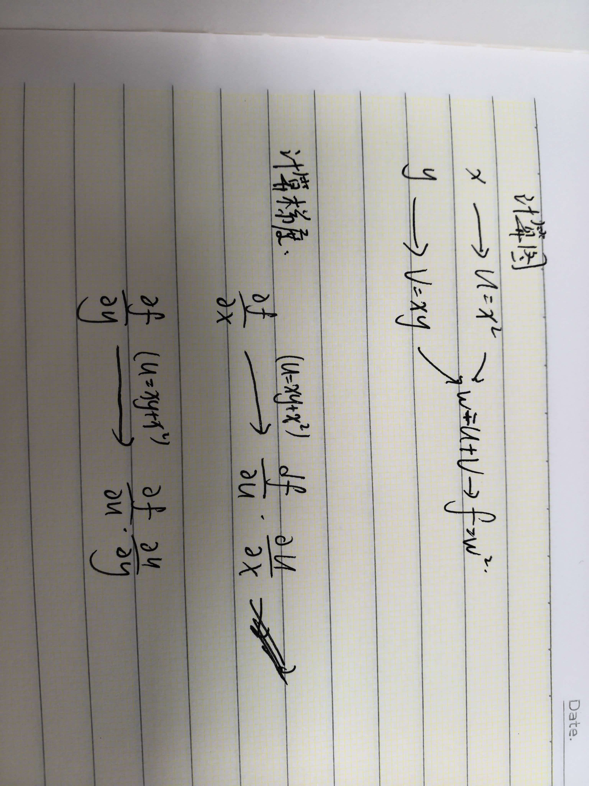

# 实践 1：简单计算链
对于函数f(x,y)=(x^2+x*y)^2

取一组你自己选择的 x和 y：

把计算过程拆成若干个简单步骤，并画出计算图；
写一段 NumPy 代码，按照计算图从后向前计算梯度；
使用 PyTorch 的 autograd 检查自己的结果是否一致。

作答：

计算图：



代码

```python
import numpy as np
x,y=2.0,3.0

u=x*y+x**2     
f=u**2
#从后向前计算
du_dx=y+2*x
du_dy=x

df_du=2*u        
df_dx=df_du*(du_dx)
df_dy=df_du*(du_dy)

print("x梯度：%d,y梯度：%d"%(df_dx,df_dy))
```

计算结果

```python
x梯度：140,y梯度：40
```

**两个结果相一致**
