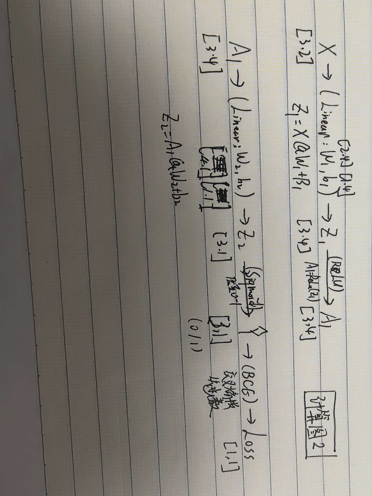

# 实践 2：神经网络的梯度
**从 Task 1 的 make_moons 数据中取出一个样本或一个很小的 batch，构造下面的两层二分类网络（参数任意）：X → Linear → ReLU → Linear → Sigmoid.需要完成一次前向传播和反向传播，不要求更新参数或训练模型：**

**1.自己确定隐藏层神经元数量，并初始化 W1,b1,W2,b2.**

根据输出，我设置隐藏层神经元数量为 4，输入特征为 2。下面是初始化代码：

```python
#每个样本有2个特征
batch_size = X_np.shape[0]  # 3
in_dim = 2
hidden_dim = 4              # 设定隐藏层神经元为 4
out_dim = 1
# 初始化参数 (使用标准的 He 初始化，方便 PyTorch 复制)
W1_np = np.random.randn(in_dim, hidden_dim).astype(np.float32) * np.sqrt(2.0 / in_dim)
b1_np = np.zeros((1, hidden_dim), dtype=np.float32)
W2_np = np.random.randn(hidden_dim, out_dim).astype(np.float32) * np.sqrt(2.0 / hidden_dim)
b2_np = np.zeros((1, out_dim), dtype=np.float32)
```

**2.使用 NumPy 完成线性层、ReLU、Sigmoid 和二元交叉熵损失的前向计算；**

前向计算代码：
```python
# 第一层：Linear
Z1 = np.dot(X_np, W1_np) + b1_np            # 形状: (3, 4)
# 激活函数：ReLU
A1 = np.maximum(0, Z1)                      # 形状: (3, 4)
# 第二层：Linear
Z2 = np.dot(A1, W2_np) + b2_np              # 形状: (3, 1)
# 激活函数：Sigmoid
Y_hat = 1.0 / (1.0 + np.exp(-Z2))           # 形状: (3, 1)

# 二元交叉熵损失 (Binary Cross Entropy)
# 加 1e-8 防止 log(0) 报错
loss_np = -np.mean(y_np * np.log(Y_hat + 1e-8) + (1 - y_np) * np.log(1 - Y_hat + 1e-8))
print(f"NumPy Loss: {loss_np:.6f}")
```
其中进行的计算是：Z1=X@W1+B1 , A1=ReLU(Z1) , Z2=A1@W2+b2

**3.画出从输入到 loss 的计算图，按照链式法则从后向前计算每个参数的梯度；**

计算图：



计算各个参数梯度的代码：
```python
# 1. Loss 对 Z2 的梯度 (BCE+Sigmoid 的神奇化简)
dZ2 = (Y_hat - y_np) / batch_size           # 形状: (3, 1)

# 2. Loss 对 W2, b2 的梯度
dW2 = np.dot(A1.T, dZ2)                     # 形状: (4, 3) @ (3, 1) -> (4, 1)
db2 = np.sum(dZ2, axis=0, keepdims=True)    # 形状: (1, 1)

# 3. Loss 对 A1 的梯度
dA1 = np.dot(dZ2, W2_np.T)                  # 形状: (3, 1) @ (1, 4) -> (3, 4)

# 4. Loss 对 Z1 的梯度 (ReLU 的导数：大于0为1，小于等于0为0)
dZ1 = dA1 * (Z1 > 0).astype(np.float32)     # 形状: (3, 4)

# 5. Loss 对 W1, b1 的梯度
dW1 = np.dot(X_np.T, dZ1)                   # 形状: (2, 3) @ (3, 4) -> (2, 4)
db1 = np.sum(dZ1, axis=0, keepdims=True)    # 形状: (1, 4)
```

**4.使用相同的输入和参数在 PyTorch 中重新完成一次前向传播，调用 autograd 得到梯度；**

利用Pytorch计算梯度的代码：
```python
X_pt = torch.tensor(X_np, dtype=torch.float32, requires_grad=False)
y_pt = torch.tensor(y_np, dtype=torch.float32, requires_grad=False)
W1_pt = torch.tensor(W1_np, dtype=torch.float32, requires_grad=True)  # <--- 加 dtype
b1_pt = torch.tensor(b1_np, dtype=torch.float32, requires_grad=True)  # <--- 加 dtype
W2_pt = torch.tensor(W2_np, dtype=torch.float32, requires_grad=True)  # <--- 加 dtype
b2_pt = torch.tensor(b2_np, dtype=torch.float32, requires_grad=True)  # <--- 加 dtype

# 前向计算
Z1_pt = torch.matmul(X_pt, W1_pt) + b1_pt
A1_pt = torch.relu(Z1_pt)
Z2_pt = torch.matmul(A1_pt, W2_pt) + b2_pt
Y_hat_pt = torch.sigmoid(Z2_pt)

loss_pt = nn.BCELoss()(Y_hat_pt, y_pt)
print(f"PyTorch Loss: {loss_pt.item():.6f}")

# 反向传播
loss_pt.backward()
```

**5.将 NumPy 手算梯度与 PyTorch 自动计算的梯度逐项比较，输出它们的形状、数值和最大绝对误差，并判断结果是否一致。**
```python
=== 梯度对比结果 ===
[dW1] 形状: (2, 4)
  Numpy 结果:
[[0.15920654 0.         0.15903752 0.15983098]
 [0.04260636 0.         0.08265738 0.08306977]]
  Torch 结果:
[[0.15920651 0.         0.15903749 0.15983097]
 [0.04260635 0.         0.08265737 0.08306977]]
  最大绝对误差: 3.40e-08
  结论: 一致 

[db1] 形状: (1, 4)
  Numpy 结果:
[[0.06341964 0.         0.1301509  0.13080024]]   #这里出现了ReLU特有的梯度消失！！
  Torch 结果:
[[0.06341963 0.         0.13015088 0.13080023]]
  最大绝对误差: 1.16e-08
  结论: 一致 

[dW2] 形状: (4, 1)
  Numpy 结果:
[[-0.20816347]
 [ 0.        ]
 [-0.7126961 ]
 [-0.93276255]]
  Torch 结果:
[[-0.20816344]
 [ 0.        ]
 [-0.712696  ]
 [-0.93276244]]
  最大绝对误差: 1.07e-07
  结论: 一致 

[db2] 形状: (1, 1)
  Numpy 结果:
[[-0.397182]]
  Torch 结果:
[[-0.39718193]]
  最大绝对误差: 7.54e-08
  结论: 一致 
```
最终结论：**一致**


PS：我完成此实践时一开始只以及用了一个样本，后来我吧batch_size扩为3，并修改了不同参数矩阵的形状。

batch_size改成3后，其中发生变化的公式和形状有：中间计算结果 Z1, A1的形状：从 (1, 4) 变成 (3, 4)，以及Z2, Y_hat的形状：从 (1, 1) 变成 (3, 1)。而且现在计算db1需要把dZ1按行加和了，得用.sum（原来不用）。


# 趁热打铁 
**1.前向传播时为什么要保存每一层的输入或输出？反向传播会在哪里用到它们？这和显存有什么关系？**

(1)反向传播求导时，很多公式需要用到前向传播的数值（例如 ReLU 需要判断输入是否大于 0，求 W 的梯度需要用到上一层的输入 A）。

(2)计算 dW2=A1转置·dZ2用到隐藏层输出A1；计算dW1 = X转置·dZ1用到输入 X。

(3)A1等中间结果必须存在显存中，直到反向传播算完对应的梯度才能释放。

PS：Batch Size 越大，保存的中间张量越大，显存占用就越高。

**2.链式法则怎样把损失函数的梯度传回第一层权重？请结合自己的计算图说明。**

根据链式法则，损失函数的梯度沿着计算图一步步反向传递。比如dW1的计算，从计算图中看看错dW1= （Loss对Z2偏导）·（Z2对A1偏导）·（A1对Z1偏导）·（Z1对W1偏导）

**3.二元交叉熵与 Sigmoid 配合后，loss 对 logit 的梯度是什么？这个结果为什么方便反向传播？**

Loss对logit的梯度是（y预测）-y，这个梯度十分的简单，这避免了配合前求Sigmoid导数时复杂的运算，并防止了梯度消失/爆炸，大大简化了反向传播的计算。

**4.NumPy 梯度与 PyTorch 梯度出现差异时，你会怎样判断问题出在公式、矩阵转置、广播还是损失的求平均方式？**

我会先看两个梯度矩阵的形状，如果形状不同，那大概率是矩阵转置出了问题。如果两个梯度形状一样，但里面的元素分别呈倍数，那可能是损失的求平均方式出了问题。如果两个矩阵某一行或列一样，别的不一样且差分别相同，那可能是广播出了问题。

**5.完成两次验证后，你现在怎样理解 loss.backward()？它替我们保存和完成了哪些工作？**


