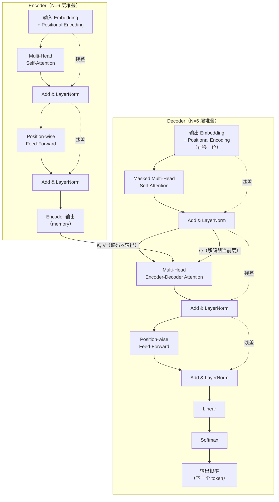

# task4 任务集

**1.阅读论文中的 Figure 1，分别找出 Encoder 和 Decoder。参考原图，用自己的方式重新画一张 简化/拓展 的 Transformer 结构图。**

**3.整理一份阅读笔记，记录你使用了哪些资料或工具、遇到了哪些读不懂的地方、后来怎样理解，以及目前仍然存在哪些疑问。**

**4.这篇论文最初处理的是什么任务？它为什么尝试不用 RNN 和 CNN？**

这篇论文最初处理的是序列转导任务，实验集中在机器翻译（WMT 2014 英德、英法），并推广到英语成分句法分析；它尝试不用 RNN 和 CNN，是因为 RNN 的隐藏状态依赖上一步，计算本质顺序、难以在样本内并行，长序列受内存和批处理限制，而 CNN 关联任意两位置所需操作随距离线性或对数增长，长距离依赖难学，Transformer 完全基于 attention，任意两位置间操作数为常数，并行度更高、训练更快且翻译质量达到新最好水平。

**5.Self-Attention 中的“Self”是什么意思？它和普通 Attention 有什么区别？**

Self-attention 中的“self”指 Q、K、V 都来自同一个序列（同一层的输出），是序列内部各位置互相注意以计算该序列的表示；它与普通 attention 的区别在于，普通或 encoder-decoder attention 的 Q 来自 decoder 当前层、K 和 V 来自 encoder 输出，是跨序列对齐，而 self-attention 是序列内部依赖建模，encoder 和 decoder 都有该子层，decoder 版本还加了 mask。

**6.Q、K、V 分别来自哪里？它们为什么要经过不同的线性变换？**

Q、K、V 的来源随应用不同：encoder 的 self-attention 中三者都来自 encoder 上一层输出；decoder 的 masked self-attention 中三者都来自 decoder 上一层输出（但被 mask 限制只能看当前位置及之前）；encoder-decoder attention 中 Q 来自 decoder 上一层，K 和 V 来自 encoder 最终输出；它们经过不同线性变换，是为了让同一输入在不同子空间分别扮演 query、key、value 的角色，学习不同投影，Q 与 K 做兼容性匹配、V 提供被加权聚合的内容，multi-head 时每个 head 还有独立的投影矩阵以关注不同表示子空间。

**7.Attention 的结果为什么要经过 softmax？得到的每一行权重表示什么？**

 Attention 结果经过 softmax，是为了把 Q 与各 K 的缩放点积兼容性分数转成非负且和为 1 的权重，形成对 V 的凸组合，同时 softmax 可微便于反向传播；得到的每一行权重表示对某个 query 位置，它分配给各个 key 位置的注意力权重，即该位置从各 value 位置聚合信息的比例，权重越大表示越关注该 key 对应位置。

**8.Multi-Head Attention 为什么要分成多个头？多个头只是把同一件事重复多次吗？**

Multi-head attention 分成多个 head 不是把同一件事重复多次，每个 head 有独立学习的投影矩阵，把 Q、K、V 投影到不同的子空间并行做 attention，再拼接并经输出投影回到模型维度，从而让模型在不同表示子空间、不同位置联合注意，避免单个 head 平均抑制多样性；论文用八个 head、每个 head 维度六十四，总计算量与全维度单 head 相近，实验也显示单 head 比最佳设置差约零点九 BLEU、head 过多同样会下降。

**9.Transformer 没有循环结构，它怎样知道词语的先后顺序？**

Transformer 没有循环结构，靠 positional encoding 知道词语先后顺序：在 encoder 和 decoder 底部把 positional encoding 加到输入 embedding 上，维度同为模型维度可直接相加；论文用不同频率的正弦和余弦函数，使任意固定偏移的 positional encoding 可表示为原 positional encoding 的线性函数，便于学习相对位置，也实验了 learned positional embedding，结果几乎一致。

**10.Decoder 中为什么需要 Masked Attention？如果能提前看到后面的答案，会发生什么？**

Decoder 需要 masked attention，是因为 decoder 是自回归的，生成位置 i 时只能依赖已生成的小于 i 的输出，masked self-attention 把 softmax 输入中对应未来位置的值设为负无穷，使其权重为零，防止向左的信息流；如果提前看到后面答案，训练时模型会作弊直接利用未来 token，训练损失很低但推理时无法获得未来信息，导致泛化崩溃，破坏自回归性质，等价于标签泄漏。

**11.残差连接、Layer Normalization 和 Feed-Forward Network 分别出现在结构图的哪里？它们大致有什么作用？**

残差连接围绕每个子层（encoder 的 self-attention、FFN；decoder 的 masked self-attention、encoder-decoder attention、FFN），形式为输入加子层输出，作用是缓解深层网络梯度消失、便于训练，并保持所有子层输出维度为五百一十二以便相加；LayerNorm 在每个残差相加之后，作用是稳定激活分布、加速收敛，且按每个样本的特征维度归一化，适合序列变长场景；FFN 位于每个 encoder 和 decoder 层中 attention 子层之后，是逐位置的两层线性加 ReLU，对每个位置单独且相同地应用，内层维度二千零四十八、输出回五百一十二，作用是提供非线性变换和逐位置特征加工，弥补 attention 主要是加权聚合的线性混合。
