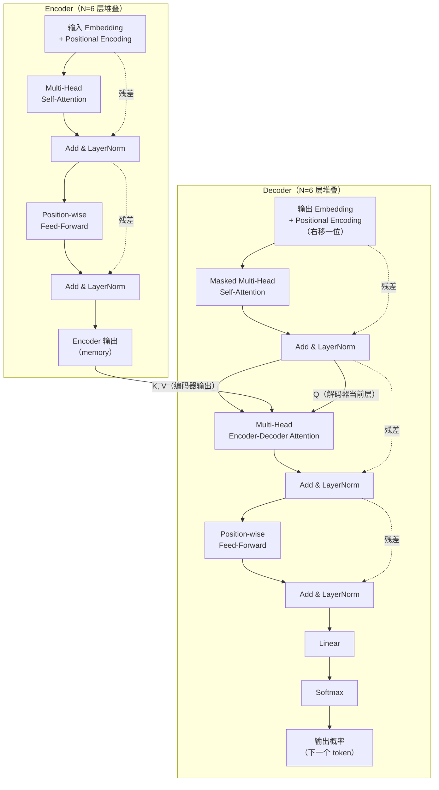

# task4 任务集

**1.阅读论文中的 Figure 1，分别找出 Encoder 和 Decoder。参考原图，用自己的方式重新画一张 简化/拓展 的 Transformer 结构图。**

**2.重点阅读论文第 3 节，了解 Scaled Dot-Product Attention、Multi-Head Attention、Position-wise Feed-Forward Network 和 Positional Encoding。**

**3.整理一份阅读笔记，记录你使用了哪些资料或工具、遇到了哪些读不懂的地方、后来怎样理解，以及目前仍然存在哪些疑问。**

**4.这篇论文最初处理的是什么任务？它为什么尝试不用 RNN 和 CNN？**

**5.Self-Attention 中的“Self”是什么意思？它和普通 Attention 有什么区别？**

**6.Q、K、V 分别来自哪里？它们为什么要经过不同的线性变换？**

**7.Attention 的结果为什么要经过 softmax？得到的每一行权重表示什么？**

**8.Multi-Head Attention 为什么要分成多个头？多个头只是把同一件事重复多次吗？**

**9.Transformer 没有循环结构，它怎样知道词语的先后顺序？**

**10.Decoder 中为什么需要 Masked Attention？如果能提前看到后面的答案，会发生什么？**

**11.残差连接、Layer Normalization 和 Feed-Forward Network 分别出现在结构图的哪里？它们大致有什么作用？**
